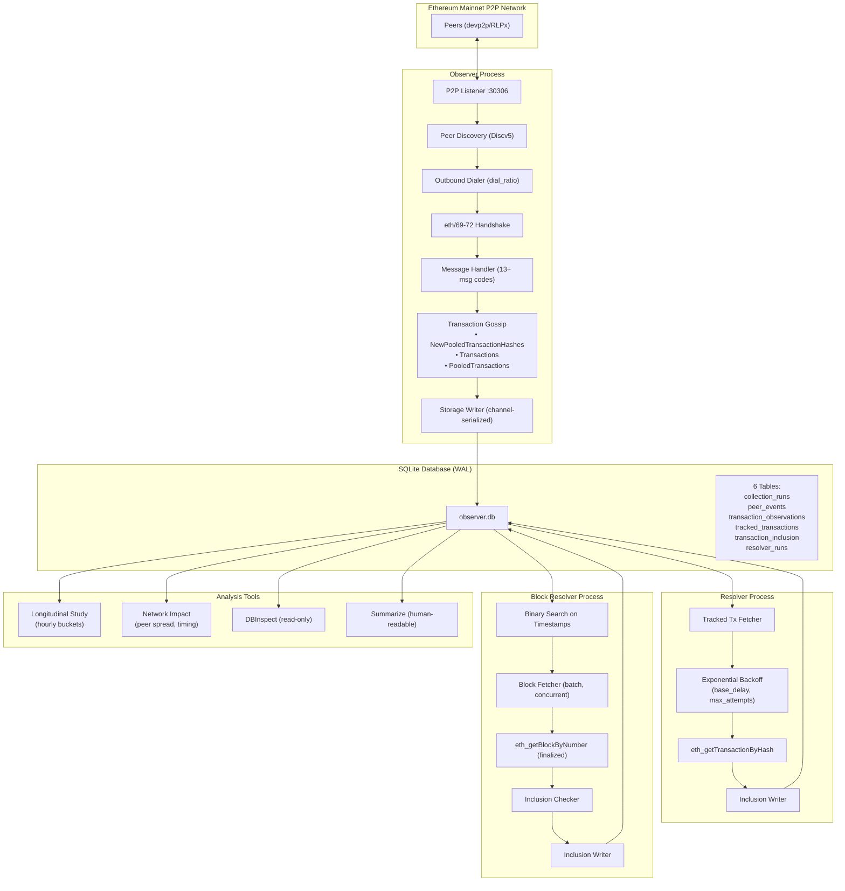
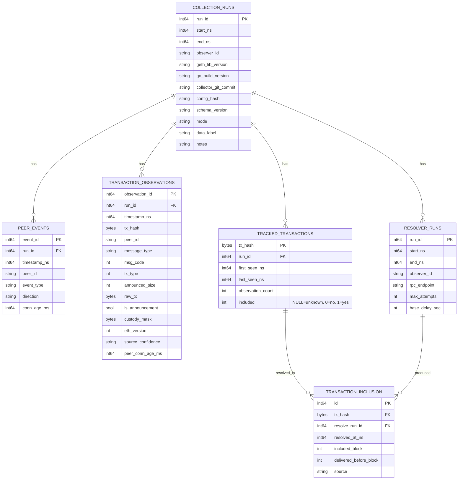

# Architecture

## Overview

Ethereum Dropper Lab is a modular system for observing Ethereum P2P transaction gossip, resolving transaction inclusion, and analyzing the results. The architecture follows a clean separation between networking, storage, and analysis layers.

## System Components

```
┌─────────────────────────────────────────────────────────────────────────────┐
│                         Ethereum Dropper Lab                                │
├─────────────────────────────────────────────────────────────────────────────┤
│                                                                             │
│  ┌──────────────┐     ┌──────────────┐     ┌──────────────┐               │
│  │   Observer   │     │   Resolver   │     │  BlockResolver│              │
│  │  (P2P/RLPx)  │     │ (eth_getTxn) │     │ (eth_getBlock)│              │
│  └──────┬───────┘     └──────┬───────┘     └──────┬───────┘               │
│         │                    │                    │                        │
│         ▼                    ▼                    ▼                        │
│  ┌──────────────────────────────────────────────────────────────────┐     │
│  │                      SQLite Storage (WAL mode)                   │     │
│  │  ┌────────────┐ ┌──────────┐ ┌────────────┐ ┌────────────────┐  │     │
│  │  │collection_ │ │ peer_    │ │ transaction│ │ tracked_       │  │     │
│  │  │runs        │ │ events   │ │ observations│ │ transactions   │  │     │
│  │  └────────────┘ └──────────┘ └────────────┘ └────────────────┘  │     │
│  │  ┌──────────────────┐ ┌─────────────────┐                        │     │
│  │  │ transaction_     │ │ resolver_runs   │                        │     │
│  │  │ inclusion        │ │                 │                        │     │
│  │  └──────────────────┘ └─────────────────┘                        │     │
│  └──────────────────────────────────────────────────────────────────┘     │
│         │                    ▲                    ▲                        │
│         ▼                    │                    │                        │
│  ┌──────────────┐           │                    │                        │
│  │   Analyzer   │───────────┘                    │                        │
│  │ (Longitudinal│                                │                        │
│  │  & Impact)   │                                │                        │
│  └──────────────┘                                │                        │
│         │                                        │                        │
│         ▼                                        │                        │
│  ┌──────────────┐     ┌──────────────┐           │                        │
│  │  DBInspect   │     │   Summarize  │───────────┘                        │
│  │  (Read-only) │     │ (Human-read) │                                    │
│  └──────────────┘     └──────────────┘                                    │
│                                                                             │
└─────────────────────────────────────────────────────────────────────────────┘
```

## Data Flow



## Key Design Decisions

### Single-Writer SQLite with Channel Serialization
All database writes go through a single goroutine (`writerLoop`) that receives write requests via a channel. This avoids SQLite locking contention and enables batch commits with busy retry logic.

### Tracked Transactions with Exponential Backoff
- Transactions are deduplicated into `tracked_transactions` at ingest time
- Inclusion status: `NULL` = unknown, `0` = not included, `1` = included
- Resolver polls `eth_getTransactionByHash` with exponential backoff (1s, 2s, 4s, 8s, 16s...)
- Results stored in append-only `transaction_inclusion` keyed by `(tx_hash, resolve_run_id)`

### Block Resolver Binary Search
- Uses `eth_getBlockByNumber` with `finalized` tag
- Binary searches block timestamps to find blocks at specific times
- Fetches blocks in batches with configurable concurrency
- More efficient for large-scale resolution than per-transaction polling

### Message Types Handled
| Code | Message | Storage Type |
|------|---------|--------------|
| 0x01 | Status | — (handshake) |
| 0x02 | NewBlockHashes | — |
| 0x03 | Transactions | `direct_broadcast` |
| 0x04 | GetBlockHeaders | — |
| 0x05 | BlockHeaders | — |
| 0x06 | GetBlockBodies | — |
| 0x07 | BlockBodies | — |
| 0x08 | NewPooledTransactionHashes | `announcement` |
| 0x09 | GetPooledTransactions | — |
| 0x0A | PooledTransactions | `pooled_tx_response` |
| 0x0D | GetNodeData | — |
| 0x0E | NodeData | — |
| 0x0F | GetReceipts | — |
| 0x10 | Receipts | — |

### Collection Runs Provenance
Each observer run creates a `collection_runs` row with:
- Git commit hash of the build
- Configuration hash (SHA256 of effective config)
- Schema version
- Mode (passive/fetch)
- Data label
- Start/end timestamps (nanoseconds)

This enables exact reproducibility and longitudinal comparison across runs.

## Storage Schema



## Concurrency Model

```
┌─────────────────────────────────────────────────────────────┐
│                    Observer Process                         │
├─────────────────────────────────────────────────────────────┤
│                                                             │
│  Main Thread                                                │
│  ├── P2P Server (accepts connections)                      │
│  ├── Peer Manager (dialer, discovery)                      │
│  └── Signal Handler (graceful shutdown)                    │
│                                                             │
│  Per-Peer Goroutines (one per connected peer)              │
│  ├── Read Loop (p2p.MsgReadWriter)                         │
│  ├── Handle Messages (dispatch to EthHandler)              │
│  └── Write Loop (p2p.Send for responses)                   │
│                                                             │
│  Storage Writer (single goroutine)                         │
│  ├── Channel Receiver (chan WriteRequest)                  │
│  ├── Batch Accumulator (commits every N or timeout)        │
│  └── Busy Retry (exponential backoff on SQLITE_BUSY)       │
│                                                             │
│  Stats Logger (periodic, separate goroutine)               │
│                                                             │
└─────────────────────────────────────────────────────────────┘
```

## Configuration Precedence

1. **Defaults** — `MainnetConfig()` hardcoded values
2. **Config File** — JSON file loaded via `--config`
3. **Command-line Flags** — Override specific fields

Example:
```json
{
  "listen_addr": ":30306",
  "max_peers": 50,
  "mode": "passive",
  "data_label": "MAINNET_OBSERVATION",
  "storage_path": "observer.db",
  "bootnodes": ["enode://...@1.2.3.4:30303", ...],
  "dial_ratio": 2,
  "tx_dissemination_enabled": false,
  "observer_id": "observer-001",
  "rpc_endpoint": "https://eth-mainnet.example.com",
  "max_attempts": 5,
  "base_delay": "1s",
  "log_level": "info"
}
```

## Build Information

The observer binary embeds build metadata:
- Git commit (via `-ldflags`)
- Go version
- go-ethereum version
- Build timestamp

This is recorded in `collection_runs.collector_git_commit` for provenance.

## Security Considerations

- **Read-only DB inspection**: `dbinspect` opens databases with `mode=ro` URI to never create/modify WAL/SHM files
- **No private keys**: Observer does not hold any Ethereum accounts or private keys
- **Rate limiting**: Transaction dissemination (if enabled) is rate-limited
- **Graceful shutdown**: Signal handling ensures clean DB close and WAL checkpoint